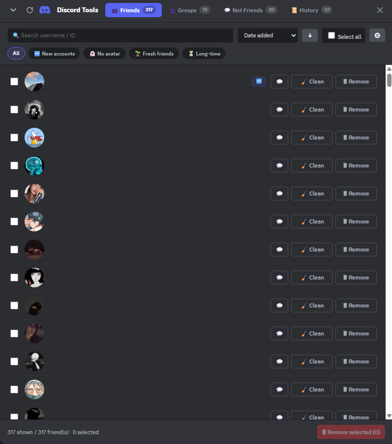

# 🛠 Discord Tools

### Clean up your Discord — friends, groups, DMs, and servers — without the pain.

A single-paste userscript that adds a native-looking panel right inside Discord Web.

**[⚡ Quick Start](#-quick-start)** · **[🖼️ Preview](#-preview)** · **[🎯 What it does](#-what-it-does)** · **[🔒 Safety](#-is-it-safe)** · **[❓ FAQ](#-faq)**

---

## ⚡ Quick Start

1. Open **[Discord](https://discord.com/app)** in your browser or the Discord App
2. Press `F12` or `CTRL + SHIFT + I` → open the **Console** tab
3. Paste the entire content of `discord-tools.js` and hit `Enter`
4. The panel appears — you're ready to go.

> 💡 Prefer automation? Use it as a **bookmarklet** or install via **Tampermonkey / Violentmonkey**.

> 🛠 **Works on all Discord web domains** — `discord.com`, `canary.discord.com`, and `ptb.discord.com`. The API base is derived from `location.host`, so there's no CORS issue on Canary/PTB.

---

## 🖼️ Preview

*The Discord Tools panel — Friends, Groups, Not Friends, Servers, and History, all in one window.*

---

## 🎯 What it does

| Tab | What you get |
|---|---|
| 👥 **Friends** | Search, sort, and filter your entire list. Remove one or many at once. Optionally wipe your DM history first, then auto-close the chat. |
| 👥 **Groups** | See every group DM you're in. Leave **silently** (no notification), and clean your messages before leaving. |
| 💬 **Not Friends** | Every DM from someone *not* on your friends list. Filter by message count, scan for empty threads, clean + close in bulk. |
| 🌐 **Servers** | List every server you're in, in your real Discord sidebar order. Mute/unmute (with duration picker), bulk-edit notification settings, rescan muted/notification state, and leave servers. |
| 📜 **History** | A running log of everything you've done — friends removed, groups left, DMs cleaned, servers left. Search, filter, and clear it anytime. |

---

## ✨ Why it feels good

- **Looks native** — Same fonts, colors, and hover states as Discord itself.
- **Live presence** — 🟢 Online · 🟡 Idle · 🔴 DND · ⚫ Offline, refreshed every 15s right on the avatar. Presence is read straight from Discord's own store.
- **Smart rate-limiting** — Adaptive delays (`AdaptiveDelay`) mean fewer `429` errors and no manual waiting. `apiFetch` retries up to 8 times with exponential backoff.
- **Real-time feedback** — Progress bars, per-conversation counters, and clear status text.
- **Server settings that stick** — Mute state and notification settings are cached in `localStorage` and re-applied on load, so the panel shows the truth without waiting for a full rescan.
- **Zero dependencies** — Pure vanilla JavaScript. No build step, no extension needed.

---

## 🧭 Tab details

### 👥 Friends
- Chips: **All**, 🆕 New accounts, 👻 No avatar, 🌱 Fresh friends (< 7 days), ⏳ Long-time (> 1 year), and a **status** chip that cycles through 🟢 Online → 🟡 Idle → 🔴 DND → ⚫ Offline.
- Sort by **date added**, **name**, **account created**, or **last DM**, with an asc/desc toggle.
- Advanced filters: added-after/before dates, and avatar type (all / default / custom).
- Per-row: **Open DM**, **🧹 Clean** (double-click to arm), **🗑 Remove** (double-click to arm).
- Bulk remove asks whether to also delete your DM messages first.

### 👥 Groups
- Chips: **All**, 👤 Solo, ✏️ Named, 💤 Inactive (> 90 days), 🆕 Recent (< 30 days), ⏳ Old (> 1 year).
- Sort by **date created**, **last activity**, **name**, or **member count**.
- A **🔇 Silent** checkbox (on by default) leaves without notifying other members.
- Bulk leave can delete your messages first, then leave — silently or not.

### 💬 Not Friends
- Automatically scans every non-friend DM on load (4 parallel workers) to count your messages.
- Chips: **All**, 💬 With my messages / 🚫 Without my messages (toggles), 📭 Empty, 🆕 New accounts, 👻 No avatar, and a status chip.
- Sort by **last DM**, **name**, **account created**, or **message count**.
- **🔄 Rescan** re-runs the message scan at any time.
- Bulk action: **Clean + close** — deletes your messages and closes the DM channel.

### 🌐 Servers
- Shows servers in your **actual Discord sidebar order** (via `getFlattenedGuildIds`, with a settings-folder fallback).
- Chips: **All**, 👑 Owned, 🔕 Muted, 🔔 Unmuted, 🆕 Recent, ⏳ Old.
- Per-row: **🔕/🔔 Mute** (with 15 min / 1 h / 8 h / 24 h / Forever picker), **⚙️ Settings**, **Open**, **🚪 Leave** (double-click to arm).
- **⚙️ Bulk Settings** applies notification/mute settings to every selected server.
- **🔕 Mute** / **🔔 Unmute** apply forever-mute to the selection.
- **🔄 Rescan** invalidates the settings cache and re-reads muted/notification state for every server (2 workers).

### 📜 History
- Every action is logged: friend removals, group leaves, non-friend DM cleans, server leaves.
- Filter by type (👤 Friends · 👥 Groups · 💬 Not-friends · 🌐 Servers) and search by name/ID.
- Stats bar shows totals and total messages deleted.
- **🗑 Clear** wipes the log.

---

## 🔒 Is it safe?

**Yes — and here's exactly why.**

- ✅ **100% client-side.** Nothing is sent to any external server.
- ✅ **Your token never leaves your browser.** It's read locally (via `localStorage` or the webpack store) and used only for `discord.com` API calls.
- ✅ **Fully readable.** Every line of `discord-tools.js` is auditable — check it yourself.
- ✅ **No analytics, no tracking, no telemetry.**

> ⚠️ **General rule:** never paste code into your console that you haven't read. This script is self-contained and open source.

---

## ❓ FAQ

**Will I get banned?**
The script uses Discord's own API with normal rate limits (`apiFetch` retries 429s up to 8 times, and `AdaptiveDelay` slows down after rate limits). Still, use it responsibly — bulk actions are permanent.

**Where is my data stored?**
- Preferences → `localStorage` (`__dt_prefs_v1`, `__dt_silent`)
- History → `window.name` (`__dt_history_v1__`, survives reloads, cleared when you close the tab)
- Server settings cache → `localStorage` (`__dt_guild_settings_v1`)

**Why does it work on Canary/PTB?**
The API base is `https://${location.host}/api/v10`, so it automatically targets the right domain and avoids CORS errors.

**Why are server mute/notification states sometimes wrong at first?**
Discord's webpack `getGuildSettings()` is obfuscated and returns i18n junk. The script instead reads real values via a `PATCH {}` on `/users/@me/guilds/{id}/settings`, caches them in `localStorage`, and lets you force a **🔄 Rescan** if needed.

**Can I undo a removal?**
No. Removing a friend, leaving a group, deleting messages, or leaving a server is **permanent**. Double-check before confirming.

**What's the "double-click to arm" behavior?**
Destructive per-row buttons (Clean / Remove / Leave) require two clicks within 3 seconds — the first click arms the button (`⚠ sure?`), the second confirms.

---

**Made with ❤️ for the Discord community**

