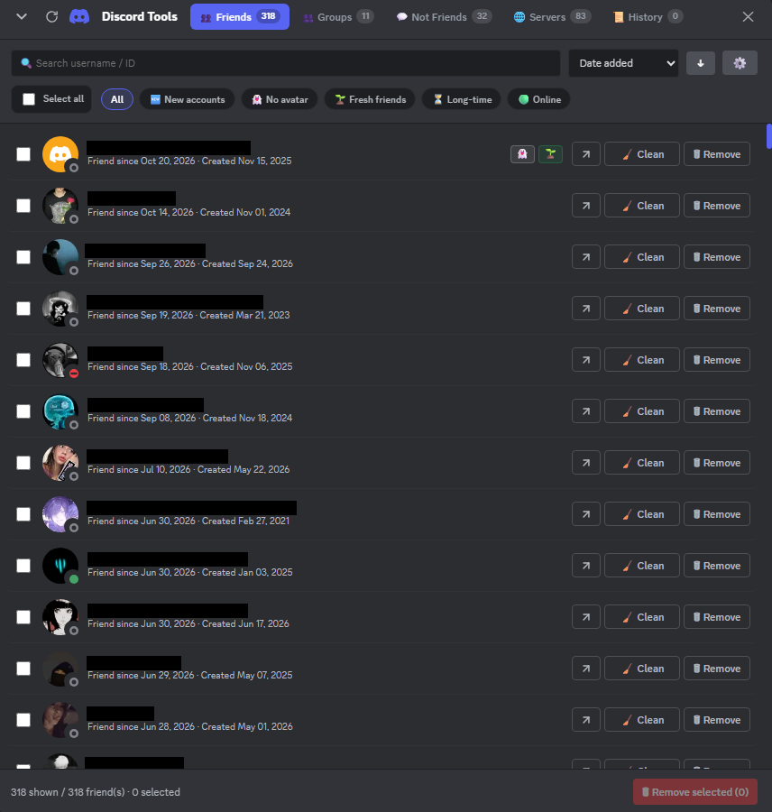
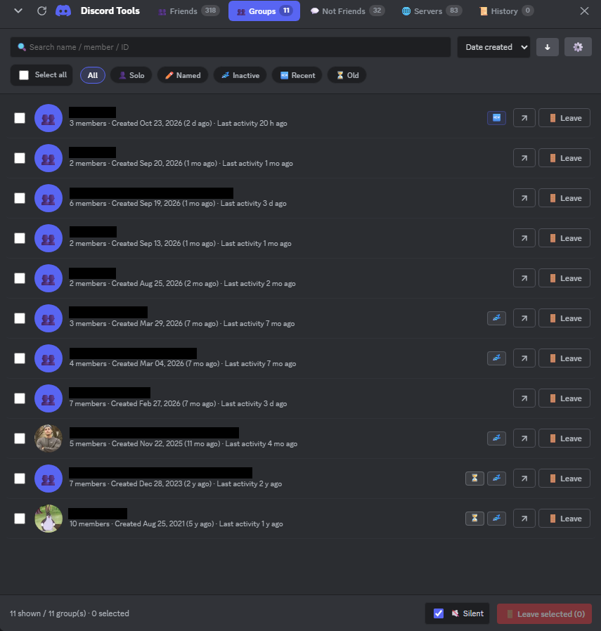
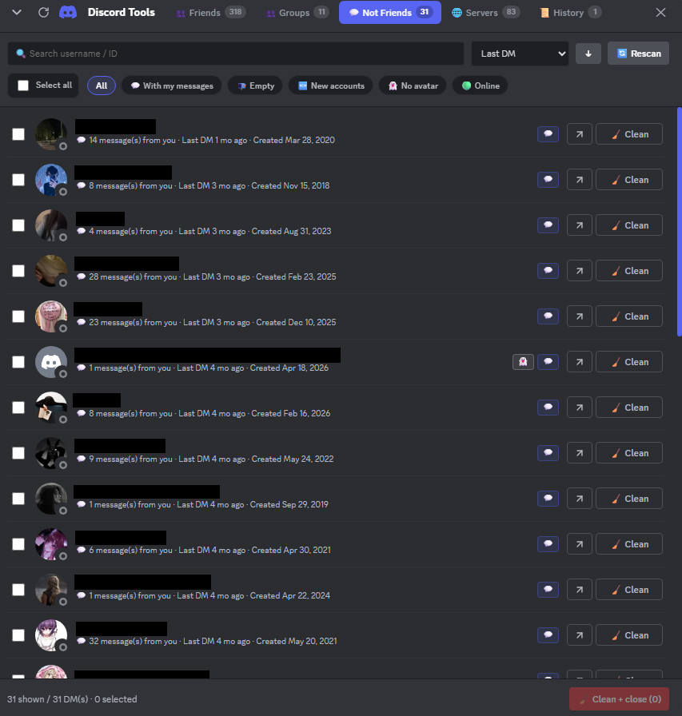
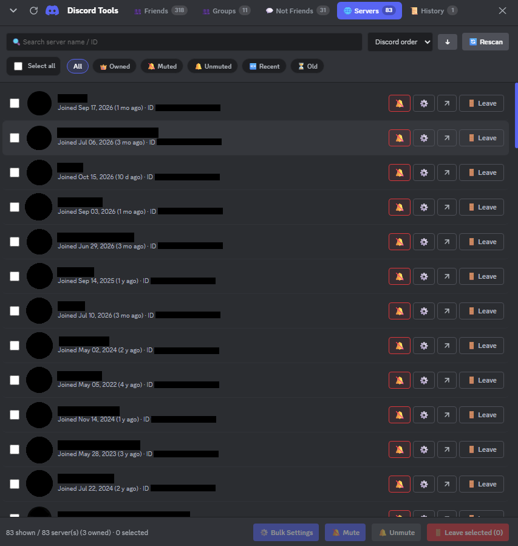
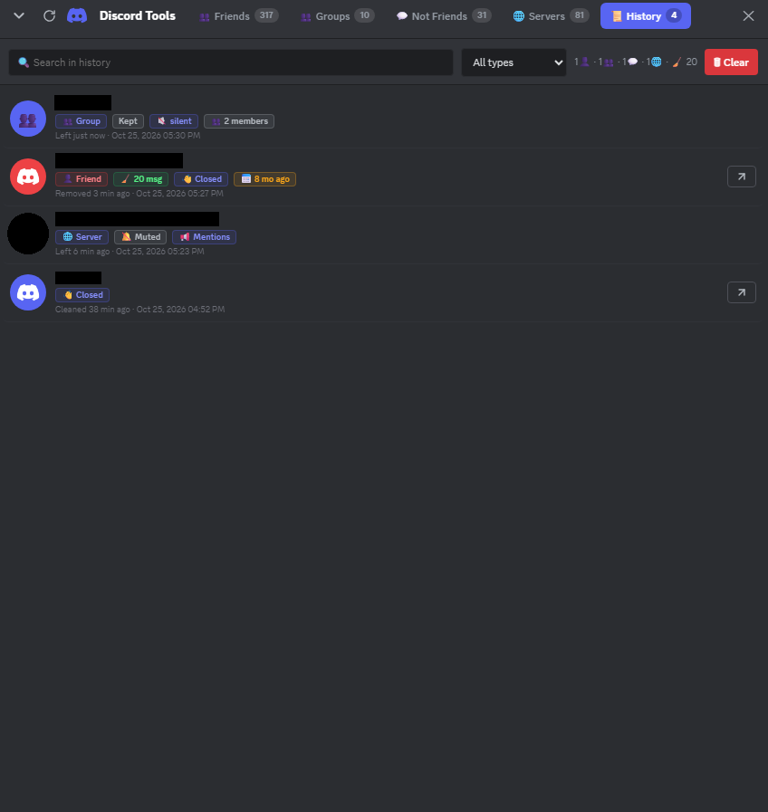

# 🛠 Discord Tools

### Clean up your Discord — friends, groups, DMs, and servers — in one paste.

A userscript that adds a native-looking panel right inside Discord Web.

**[⚡ Quick Start](#-quick-start)** · **[🎯 Features](#-features)** · **[🔒 Safety](#-is-it-safe)** · **[❓ FAQ](#-faq)**

---

## ⚡ Quick Start

1. Open **[Discord](https://discord.com/app)** (works on `discord.com`, `canary.`, `ptb.`)
2. Press `F12` → **Console** tab
3. Paste the entire content of `discord-tools.js` → `Enter`
4. Done. The panel appears.

> 💡 Also works as a **bookmarklet** or via **Tampermonkey / Violentmonkey**.

---

## 🎯 Features

| Tab | What it does |
|---|---|
| 👥 **Friends** | Search, filter, sort, remove in bulk. Optionally wipe your DM history first, then auto-close the chat. |
| 👥 **Groups** | Leave group DMs silently (no notification), optionally deleting your messages first. |
| 💬 **Not Friends** | Every DM from a non-friend. Filter by message count, clean + close in bulk. |
| 🌐 **Servers** | Mute/unmute (with duration), bulk-edit notification settings, rescan state, leave servers. |
| 📜 **History** | Log of everything you've done. Search, filter, clear. |

### Why it feels good

- **Native look** — same fonts, colors, hover states as Discord.
- **Live presence** — 🟢 🟡 🔴 ⚫ refreshed every 15s on each avatar.
- **Smart rate-limiting** — adaptive delays, no manual waiting on `429`s.
- **Real-time feedback** — progress bars, per-conversation counters.
- **Zero dependencies** — pure vanilla JS, no build step.

---

👥 Friends — preview

**Chips:** All · 🆕 New · 👻 No avatar · 🌱 Fresh · ⏳ Long-time · 🟢🟡🔴⚫ Status
**Sort:** date added · name · account created · last DM
**Per row:** Open DM · 🧹 Clean · 🗑 Remove (double-click to arm)
**Bulk:** remove + optional DM wipe, auto-close chat

👥 Groups — preview

**Chips:** All · 👤 Solo · ✏️ Named · 💤 Inactive · 🆕 Recent · ⏳ Old
**Sort:** created · last activity · name · members
**Silent** checkbox (on by default) — leave without notifying members
**Bulk:** delete your messages + leave, silently or not

💬 Not Friends — preview

Auto-scans every non-friend DM on load (4 workers) to count your messages.
**Chips:** All · 💬 With messages / 🚫 Without · 📭 Empty · 🆕 New · 👻 No avatar · Status
**Sort:** last DM · name · account created · message count
**🔄 Rescan** re-runs the scan anytime
**Bulk:** clean + close

🌐 Servers — preview

Listed in your real Discord sidebar order.
**Chips:** All · 👑 Owned · 🔕 Muted · 🔔 Unmuted · 🆕 Recent · ⏳ Old
**Per row:** 🔕/🔔 Mute (15m/1h/8h/24h/Forever) · ⚙️ Settings · Open · 🚪 Leave (double-click)
**Bulk:** Settings · Mute · Unmute · Leave
**🔄 Rescan** refreshes muted/notification state

📜 History — preview

Every action logged: friends removed, groups left, DMs cleaned, servers left.
Filter by type · search by name/ID · stats bar · 🗑 Clear

---

## 🔒 Is it safe?

- ✅ **100% client-side** — nothing sent to any external server.
- ✅ **Your token never leaves your browser** — used only for `discord.com` API calls.
- ✅ **Fully readable** — every line is auditable.
- ✅ **No analytics, tracking, or telemetry.**

> ⚠️ Never paste code into your console that you haven't read.

---

## ❓ FAQ

**Will I get banned?**
No — it uses Discord's own API with normal rate limits (auto-retry on `429`). Still, use it responsibly: bulk actions are permanent.

**Where is my data stored?**
- Preferences → `localStorage`
- History → `window.name` (cleared when you close the tab)
- Server settings cache → `localStorage`

**Can I undo?**
No. Removing a friend, leaving a group/server, or deleting messages is **permanent**.

**Why are server mute states sometimes wrong at first?**
Discord's webpack store is obfuscated. The script reads real values via the API, caches them, and offers a **🔄 Rescan**.

**Why the "double-click to arm" on buttons?**
To prevent accidental destructive clicks — first click arms (`⚠ sure?`), second confirms.

---

**Made with ❤️ for the Discord community**

